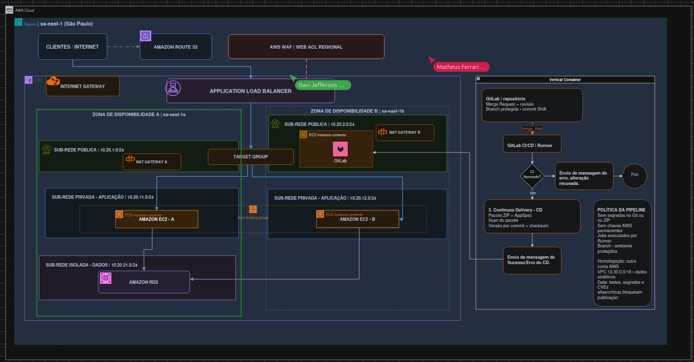

# 🐾 PetCare Cloud — Auditoria de Sistemas (Parte 2)

Plataforma de gestão de pet shop (React + Go + MongoDB + SNS/SQS/Lambda) implantada na AWS com
**infraestrutura 100% em Terraform**, **rede segmentada em 3 camadas**, **ALB + AWS WAF** e
**pipeline GitLab CI/CD auto-hospedada com SAST, SCA, detecção de segredos e análise de IaC**.



| Requisito do trabalho | Onde está |
|---|---|
| Fluxo de desenvolvimento completo, CI/CD com SAST | [`.gitlab-ci.yml`](.gitlab-ci.yml) · GitLab CE em [`terraform/modules/gitlab`](terraform/modules/gitlab) |
| Provisionamento com Terraform (plano de DR) | [`terraform/`](terraform) · [Runbook de DR](#-plano-de-disaster-recovery-runbook) |
| Segmentação de redes | [`terraform/modules/network`](terraform/modules/network) · [`terraform/modules/security`](terraform/modules/security) |
| Controlador de carga com WAF | [`terraform/modules/edge`](terraform/modules/edge) |
| Aplicação funcional | [`petcare/`](petcare) — CRUD de clientes, pets, agendamentos, dashboard, eventos SNS/SQS/Lambda |
| Evidências de auditoria | [`docs/AUDITORIA.md`](docs/AUDITORIA.md) · [`docs/ROTEIRO-TESTES.md`](docs/ROTEIRO-TESTES.md) |

---

## 🏗️ Arquitetura implementada

```text
                         Usuários (HTTP)
                               │
                 ┌─────────────▼──────────────┐
                 │  AWS WAF (Web ACL regional) │  rate limit · IP reputation · OWASP/XSS
                 │                             │  SQLi · Log4j · caminhos sensíveis
                 └─────────────┬──────────────┘
 VPC 10.20.0.0/16              │
┌──────────────────────────────▼──────────────────────────────────────────────┐
│  PÚBLICA   10.20.1.0/24 (AZ a)              10.20.2.0/24 (AZ b)              │
│            ALB · NAT Gateway A              ALB · NAT Gateway B · GitLab+Runner│
│                              │ Target Group (HTTP 80, /health)               │
│  PRIVADA   10.20.11.0/24 ── EC2-A ──┐   ┌── EC2-B ── 10.20.12.0/24           │
│  (app)     Nginx + API Go   Auto Scaling Group (2–4)  sem IP público          │
│                              │ 27017 (somente SG-APP)                        │
│  ISOLADA   10.20.21.0/24  MongoDB (EBS criptografado, snapshots diários)     │
│  (dados)   sem rota p/ internet · NACL própria · VPC endpoints S3/SSM        │
└──────────────────────────────────────────────────────────────────────────────┘
 Fora da VPC: S3 (releases, logs) · CodeDeploy · SNS/SQS/Lambda · SSM Parameter Store · Route 53 privado
```

**Fluxo de entrega (diagrama, lado direito):**
`Merge Request + revisão → merge na main (branch protegida) → GitLab Runner → CI aprovada?`
→ **não:** e-mail de erro, alteração recusada → **sim:** pacote ZIP + AppSpec, scan do pacote,
versão = commit + SHA-256 → S3 → CodeDeploy (uma instância por vez, rollback automático) → e-mail de sucesso/erro.

### Desvios do desenho original (limitações do AWS Academy Learner Lab)

| Desenho | Implementado | Motivo |
|---|---|---|
| `sa-east-1` | `us-east-1` (variável `aws_region`) | Learner Lab só libera us-east-1/us-west-2 |
| Amazon RDS | MongoDB em EC2 na sub-rede isolada | Aplicação já usa MongoDB (decisão do grupo) |
| HTTPS/ACM + Route 53 público | HTTP no ALB + Route 53 **privado** | Learner Lab não permite registrar domínio |
| OIDC GitLab → IAM | Instance Profile (credenciais temporárias via IMDSv2) | Learner Lab não permite criar roles/OIDC; objetivo "sem chaves permanentes" mantido |

---

## 🚀 Plano de Disaster Recovery (runbook)

Todo o ambiente de produção (rede, segurança, WAF, servidores, banco, GitLab, pipeline) é recriado
do zero, em outra conta/região se necessário, com **dois comandos**. RTO estimado: ~30 min.

### Pré-requisitos
- Terraform ≥ 1.6, Git e curl
- Credenciais do Learner Lab: **AWS Details → AWS CLI → copiar para `~/.aws/credentials`**

### Passo a passo

```bash
# 1) Variáveis (arquivo ignorado pelo Git)
cd terraform
cp terraform.tfvars.example terraform.tfvars
#   admin_cidrs        = ["<seu IP>/32"]      # curl -s ifconfig.me
#   notification_email = "<e-mail do grupo>"

# 2) Infraestrutura completa (~10 min)
terraform init
terraform apply

# 3) Confirme a inscrição SNS no e-mail recebido ("AWS Notification - Subscription Confirmation")

# 4) Bootstrap do GitLab: aguarda ficar pronto (~15 min), envia o código e trava a main
cd ..
./scripts/bootstrap-gitlab.sh
```

A primeira pipeline roda automaticamente e publica a aplicação. Acompanhe em
`<gitlab_url>/root/petcare/-/pipelines`; a aplicação fica em `terraform output app_url`.

| Saída útil | Comando |
|---|---|
| URL da aplicação | `terraform output app_url` |
| URL do GitLab | `terraform output gitlab_url` |
| Senha root do GitLab | `terraform output -raw gitlab_root_password` |
| Shell no MongoDB (sem SSH) | `terraform output ssm_session_mongo` |

### Recuperação de dados
O volume do MongoDB tem snapshot diário (Lambda agendada pelo EventBridge, retenção de 7 dias; o primeiro é feito no próprio `apply`). Para restaurar: criar volume a partir
do snapshot no console EC2 e anexá-lo à instância do MongoDB (ou importar com
`terraform import module.data.aws_ebs_volume.data <vol-id>`).

### Encerrar (economizar créditos)
```bash
cd terraform && terraform destroy
```
Custo aproximado ligado: **US$ 5–6/dia** (2 NAT Gateways, ALB, GitLab t3.large, 3× t3.small).
O Learner Lab desliga as EC2 ao fim da sessão; ao reabrir, o GitLab leva ~5 min para voltar.

---

## 🔁 Fluxo de desenvolvimento

```bash
git checkout -b feature/nova-tela
# ... altera código ...
git push gitlab feature/nova-tela        # remoto criado pelo bootstrap
```
1. Abrir **Merge Request** para `main` no GitLab → pipeline de CI roda (testes + segurança + pacote).
2. Merge só é permitido com pipeline verde (`only_allow_merge_if_pipeline_succeeds`); push direto na `main` é bloqueado.
3. Após o merge, a pipeline da `main` faz o **deploy** e o **smoke test** em produção.
4. E-mail de sucesso ou falha é enviado via SNS.

### Estágios da pipeline

| Estágio | Job | Ferramenta | Bloqueia se |
|---|---|---|---|
| test | `test:backend` | `go vet`, `gofmt`, `go test` | teste falhar / código fora do padrão |
| test | `test:frontend` | `npm ci && vite build` | build falhar |
| test | `test:lambda` | Python | Lambda não processar evento |
| security | `sast:semgrep` | **Semgrep** (SAST) | qualquer achado (Go/React/Python) |
| security | `secrets:gitleaks` | **Gitleaks** | segredo na árvore ou nos commits novos |
| security | `sca:trivy` | **Trivy** (SCA) | CVE ALTA/CRÍTICA com correção |
| security | `iac:checkov` | **Checkov** (IaC) | regra falha sem justificativa |
| security | `iac:terraform` | `terraform fmt/validate` | IaC inválida |
| package | `package` | Trivy (scan do pacote + SBOM), zip, sha256 | CVE/segredo no artefato |
| deploy | `deploy:producao` | S3 + CodeDeploy (main) | deploy falhar → rollback automático |
| deploy | `verify:producao` | curl | versão errada, banco fora, WAF não bloqueando SQLi |
| notify | `notify:sucesso` / `notify:falha` | SNS → e-mail | — |

---

## 💻 Desenvolvimento local

```bash
cd petcare && docker compose up --build
# Frontend: http://localhost:3000  ·  API: http://localhost:8080/health
```

## 📁 Estrutura

```text
.
├── .gitlab-ci.yml              # pipeline CI/CD
├── docs/                       # diagrama, relatório de auditoria, roteiro de testes
├── scripts/bootstrap-gitlab.sh # push inicial + trava da branch main
├── petcare/
│   ├── backend/                # API Go (Gin) + testes
│   ├── frontend/               # React (Vite)
│   ├── lambda/                 # processamento de agendamentos (Python)
│   ├── deploy/                 # appspec.yml, hooks, systemd, nginx (pacote CodeDeploy)
│   └── docker-compose.yml      # ambiente local
└── terraform/
    ├── main.tf / variables.tf / outputs.tf
    └── modules/
        ├── network/    # VPC, 5 sub-redes, IGW, 2 NAT, rotas, NACL, endpoints, flow logs
        ├── security/   # Security Groups em cadeia
        ├── edge/       # ALB, Target Group, WAF + logs
        ├── compute/    # Launch Template + Auto Scaling Group
        ├── data/       # MongoDB isolado, EBS, snapshots, segredos SSM
        ├── gitlab/     # GitLab CE + Runner (bootstrap automatizado)
        ├── pipeline/   # S3 releases, CodeDeploy, SNS de notificação
        └── messaging/  # SNS/SQS/DLQ/Lambda da aplicação
```
